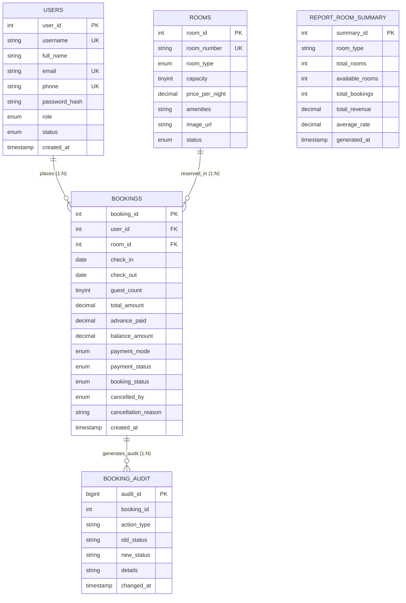

# Comprehensive DBMS Mini Project Report
## Hotel Room Reservation and Management System

---

### Project Information
* **Project Title:** Hotel Room Reservation & Management System
* **Domain:** Hospitality / Hotel Property Management
* **Database Management System:** MySQL Server 8.0+
* **Backend Application Framework:** Python 3.10+ / Flask
* **Frontend Technologies:** HTML5, CSS3, JavaScript, Bootstrap 5, FontAwesome
* **Target Normalization Level:** Third Normal Form (3NF)
* **Key Enhancements Implemented:**
  1. Strict Email & Mobile Phone Format Verification and Database Uniqueness.
  2. Room Reservation Checkout Process with 25% Advance Payment Requirement and Mode of Payment Selection.
  3. Administrative Booking Cancellation with Unavoidable Reason Logging and Guest Notification.
  4. Real Curated High-Definition Sample Photography for Every Room Category.

---

## 1. Real-World Scenario & Problem Statement

### 1.1 Real-World Scenario
In the modern hospitality sector, independent and boutique hotels frequently struggle with manual or semi-automated room booking workflows. Front-desk personnel often track reservations using spreadsheets or unnormalized databases. Such legacy systems face major operational hurdles:
- **Double Bookings & Scheduling Conflicts:** Inquiries for the same room category over overlapping dates lead to room conflicts.
- **Unverified Contacts & Duplicate Records:** Lack of email and mobile verification leads to duplicate accounts and unreachable guests.
- **Revenue Leakage without Advance Payments:** Guests frequently book rooms but fail to arrive, creating lost revenue for the hotel. Requiring a **25% advance booking deposit** guarantees guest commitment.
- **Lack of Centralized Audit Trails:** When a booking is modified or cancelled by hotel management (e.g., due to unavoidable emergency maintenance), guests are often left uninformed regarding why their stay was cancelled and whether their advance deposit was refunded.

### 1.2 Clear and Concise Problem Statement
> *"To design, normalize, and implement a robust, secure, and centralized Relational Database Management System (RDBMS) for a hotel property using MySQL, paired with a modern Python Flask web application. The system enforces unique email and mobile verification during registration, features a dedicated checkout flow calculating a mandatory 25% advance payment across multiple payment modes (Card, UPI/QR, Net Banking), equips administrators with full control to cancel bookings while logging unavoidable operational reasons that are prominently displayed to the guest, and demonstrates core and advanced SQL features including multi-table joins, correlated subqueries (NOT EXISTS), aggregate grouping, views, performance indexes, database triggers for automated auditing, stored procedures with IN/OUT parameters, and row-by-row cursor processing."*

---

## 2. Project Objectives & Scope

### 2.1 Objectives
1. **Normalized Relational Schema:** Model the hotel domain in Third Normal Form (3NF) to eliminate data redundancy and insertion/deletion anomalies.
2. **Contact Verification & Uniqueness:** Ensure every registered user possesses a verified, syntactically valid, and strictly unique email address and mobile phone number.
3. **Checkout Process & 25% Advance Booking:** When reserving any room, calculate stay duration, compute the total stay cost, require an upfront **25% advance payment**, record the chosen payment mode (Card, UPI, Net Banking), and track the 75% balance due at check-in.
4. **Collision-Free Date Reservations:** Use SQL correlated subqueries (`NOT EXISTS`) and transactional row locking (`FOR UPDATE`) to prevent overlapping reservations.
5. **Administrative Cancellation with Notice:** If hotel administration cancels a reservation, store the operational reason (`Cancelled by Hotel Administration due to unavoidable operational/maintenance reasons`) and render a high-visibility alert on the customer's dashboard confirming advance refund status.
6. **Curated Room Photography:** Equip every room with high-definition photos representing Standard, Deluxe, Suite, Family, and Executive lodging.
7. **Database-Enforced Logic:** Automated audit logging via Triggers, monthly calculations via Stored Procedures, and row-by-row aggregation via Cursors.

---

## 3. Database Design & Entity-Relationship (ER) Modeling

### 3.1 Entity Identification & Attribute Definitions

1. **`users` (User Accounts):**
   - `user_id` (INT, PK, AUTO_INCREMENT = 1001): Surrogate primary key.
   - `username` (VARCHAR(50), UNIQUE): Unique user handle.
   - `full_name` (VARCHAR(100)): Full legal name.
   - `email` (VARCHAR(150), UNIQUE): Verified, unique contact email.
   - `phone` (VARCHAR(20), UNIQUE): Verified, unique 10-digit mobile number.
   - `password_hash` (VARCHAR(255)): Secure cryptographic password hash.
   - `role` (ENUM('customer', 'admin')): Role identifier.
   - `status` (ENUM('Active', 'Inactive')): Account access flag.
   - `created_at` (TIMESTAMP): Registration timestamp.

2. **`rooms` (Physical Room Inventory):**
   - `room_id` (INT, PK, AUTO_INCREMENT = 101): Surrogate primary key.
   - `room_number` (VARCHAR(10), UNIQUE): Room label ('101', '201', '301', etc.).
   - `room_type` (ENUM('Standard', 'Deluxe', 'Suite', 'Family', 'Executive')).
   - `capacity` (TINYINT UNSIGNED): Max allowable guests (`CHECK (capacity BETWEEN 1 AND 10)`).
   - `price_per_night` (DECIMAL(10,2)): Base nightly rate (`CHECK (price_per_night > 0)`).
   - `amenities` (VARCHAR(500)): Amenities string.
   - `image_url` (VARCHAR(500)): Direct photo URL for the room.
   - `status` (ENUM('Available', 'Maintenance', 'Inactive')).

3. **`bookings` (Reservation Transactions with 25% Advance):**
   - `booking_id` (INT, PK, AUTO_INCREMENT = 5001): Booking transaction primary key.
   - `user_id` (INT, FK → `users.user_id`): Customer placing reservation.
   - `room_id` (INT, FK → `rooms.room_id`): Room reserved.
   - `check_in` (DATE): Check-in date.
   - `check_out` (DATE): Check-out date (`CHECK (check_out > check_in)`).
   - `guest_count` (TINYINT UNSIGNED): Guests staying (`CHECK (guest_count > 0)`).
   - `total_amount` (DECIMAL(10,2)): Total stay amount (`nights * price_per_night`).
   - `advance_paid` (DECIMAL(10,2)): 25% upfront booking deposit.
   - `balance_amount` (DECIMAL(10,2)): Remaining 75% balance due at check-in.
   - `payment_mode` (ENUM('Credit/Debit Card', 'UPI / QR', 'Net Banking', 'Cash at Arrival')).
   - `payment_status` (ENUM('Advance Paid', 'Fully Paid', 'Pending', 'Refunded')).
   - `booking_status` (ENUM('Confirmed', 'Cancelled', 'Checked In', 'Checked Out')).
   - `cancelled_by` (ENUM('customer', 'admin') NULL): Discriminates who cancelled the stay.
   - `cancellation_reason` (VARCHAR(255) NULL): Logged operational reason.
   - `created_at` (TIMESTAMP): Booking creation timestamp.

4. **`booking_audit` (Trigger Audit Trail):**
   - `audit_id` (BIGINT, PK, AUTO_INCREMENT).
   - `booking_id` (INT), `action_type` (VARCHAR(30)), `old_status` (VARCHAR(30)), `new_status` (VARCHAR(30)), `details` (VARCHAR(255)), `changed_at` (TIMESTAMP).

5. **`report_room_summary` (Cursor Aggregation Table):**
   - `summary_id` (INT, PK), `room_type` (VARCHAR(50)), `total_rooms` (INT), `available_rooms` (INT), `total_bookings` (INT), `total_revenue` (DECIMAL(12,2)), `average_rate` (DECIMAL(10,2)), `generated_at` (TIMESTAMP).

---

### 3.2 Entity-Relationship (ER) Diagram

---

## 4. Normalization Analysis (Up to 3NF)

### 4.1 First Normal Form (1NF)
* Criteria: All attribute values are atomic; relations possess a declared primary key; no repeating groups.
* Implementation: Tables `users`, `rooms`, `bookings`, `booking_audit`, and `report_room_summary` all define scalar atomic attributes.

### 4.2 Second Normal Form (2NF)
* Criteria: Must be in 1NF with **zero partial dependencies** (every non-key attribute must depend on the whole primary key).
* Implementation: All tables utilize single-column surrogate primary keys (`user_id`, `room_id`, `booking_id`). Since no composite candidate keys exist, partial functional dependencies are mathematically eliminated.

### 4.3 Third Normal Form (3NF)
* Criteria: Must be in 2NF with **zero transitive dependencies** (non-key attributes depend only on the primary key, not on other non-key attributes).
* Implementation:
  - User contact and profile attributes depend strictly on `user_id`.
  - Room specs, pricing, and photo URL depend strictly on `room_id`.
  - Booking attributes (`check_in`, `check_out`, `advance_paid`, `balance_amount`, `payment_mode`, `booking_status`, `cancellation_reason`) depend strictly on `booking_id`.
  - `total_amount`, `advance_paid`, and `balance_amount` represent immutable transaction receipts locked at the moment of booking. If room pricing is modified subsequently, existing booking values remain unaltered, preserving financial auditability.

---

## 5. Advanced Database Features

### 5.1 Automated Triggers
1. **`trg_booking_insert_audit` (AFTER INSERT ON bookings):**
   Fires automatically upon booking creation, logging the event with initial status and advance deposit recorded into `booking_audit`.
2. **`trg_booking_status_audit` (AFTER UPDATE ON bookings):**
   Fires upon any status transition (`Confirmed` → `Checked In` or `Cancelled`). If cancelled by management, logs the exact `cancellation_reason`.

### 5.2 Stored Procedures
1. **`sp_monthly_booking_summary(p_year, p_month)`:**
   Calculates monthly booking counts, confirmed volume, advance collections, and total recognized revenue.
2. **`sp_get_room_type_stats(p_room_type, OUT ...)`:**
   Demonstrates both `IN` and `OUT` parameters for procedural calculations.

### 5.3 Cursor Stored Procedure (`sp_process_occupancy_cursor`)
Iterates row-by-row through each distinct room category using a `CURSOR`, calculating occupancy and financial aggregates, and inserting results into `report_room_summary`.

---

## 6. User Interface & Key Workflow Demonstrations

### 6.1 User Registration with Strict Email OTP Verification (`/register`)
- Evaluates email syntax via regular expression patterns.
- Dispatches a live 6-digit One-Time Password (OTP) to the customer's actual email address via transactional email services (Resend API / Brevo SMTP relay).
- Requires entering and verifying the OTP before account creation can proceed.
- Evaluates phone numbers to ensure a valid 10-digit mobile number.
- Enforces strict uniqueness for both email and phone in MySQL.

### 6.2 Room Discovery & Lodging Options (`/rooms`)
- Displays lodging choices (Standard, Deluxe, Suite, Family, Executive).
- Real room photos shown on every room card.
- Nested `NOT EXISTS` subquery ensures that only rooms with zero date collisions are presented.

### 6.3 Checkout & Dynamic Wi-Fi QR Code Advance Payment (`/checkout/<room_id>`)
- Detailed reservation summary: room photo, dates, nights, guests.
- Transparent price breakdown:
  - Total stay cost
  - **Required 25% advance booking deposit**
  - Remaining 75% balance payable at check-in
- **Dynamic Scannable Payment QR Code:**
  - Dynamically generated QR code bound to the server's local Wi-Fi / LAN IP address.
  - Scannable from any smartphone connected to the same Wi-Fi network.
  - Opens a dedicated mobile payment sheet (`/pay/<order_id>`) with dummy UPI (Google Pay, PhonePe, Paytm), Card, and Net Banking simulation.
  - Real-time desktop polling (`/api/payment_status/<order_id>`) detects mobile payment approval and automatically confirms the booking.

### 6.4 Customer Dashboard & Admin Cancellation Notice (`/dashboard`)
- Displays all customer stays with stay periods, duration, total price, and 25% advance paid.
- If a reservation is cancelled by the hotel administration:
  - Renders a prominent notice:
    *"Notice: This booking was cancelled by the hotel administration due to unavoidable operational/maintenance reasons. Any advance payment of ₹X will be refunded to your original payment mode."*

### 6.5 Admin Management Center (`/admin/*`)
- **Dashboard (`/admin`):** Property KPIs, advance revenue, and recent bookings.
- **Rooms Management (`/admin/rooms`):** Add, edit photos/prices/amenities, toggle maintenance status, delete rooms.
- **Bookings Management (`/admin/bookings`):** Review bookings, perform check-in/check-out, or cancel with unavoidable operational reasons.
- **DBMS Diagnostics Hub (`/admin/database`):** Live Trigger Audit Trail, Cursor execution runner, Views inspector, and SQL query showcase.

---

## 7. Test Cases & Verification Results

| Test Case | Module | Input Data | Expected Result | Actual Result | Status |
| :--- | :--- | :--- | :--- | :--- | :---: |
| **TC-01** | Landing Page | Open `/` | Displays room showcase, real room photos, and 25% advance badge | Rendered with HTTP 200 | **PASS** |
| **TC-02** | Email Verification | Email `bad-email` | Rejected with message: "Please enter a valid email address" | Flash error displayed | **PASS** |
| **TC-03** | Phone Verification | Phone `123` | Rejected with message: "Please enter a valid 10-digit mobile number" | Flash error displayed | **PASS** |
| **TC-04** | Email Uniqueness | Existing email `john@example.com` | Rejected with duplicate email notice | Rejected by MySQL check | **PASS** |
| **TC-05** | Phone Uniqueness | Existing phone `+91 9123456780` | Rejected with duplicate phone notice | Rejected by MySQL check | **PASS** |
| **TC-06** | Checkout Page | Choose dates for Room 101 | Calculates 25% advance and 75% balance with payment modes | Checkout screen rendered | **PASS** |
| **TC-07** | Booking Confirmation | Pay 25% advance via Card | Booking stored with `advance_paid`, `balance_amount`, `payment_mode` | Booking #5006 confirmed | **PASS** |
| **TC-08** | Date Collision | Search dates for booked room | Room excluded via correlated `NOT EXISTS` subquery | Excluded from results | **PASS** |
| **TC-09** | Admin Cancellation | Admin cancels with unavoidable reason | `cancelled_by='admin'`, reason stored, trigger audits change | Stored in MySQL | **PASS** |
| **TC-10** | Guest Cancel Notice | Customer logs into `/dashboard` | Prominent alert displayed with unavoidable cancellation reason & refund info | Banner displayed | **PASS** |
| **TC-11** | Stored Procedure | Execute `sp_monthly_booking_summary` | Returns monthly totals and advance collections | Totals displayed | **PASS** |
| **TC-12** | Cursor Routine | Call `sp_process_occupancy_cursor()` | Computes row-by-row metrics into `report_room_summary` | 5 categories calculated | **PASS** |

---

## 8. Conclusion
The Hotel Room Reservation and Management System delivers an academically rigorous, fully functional DBMS mini project. By enforcing verified unique email and phone constraints, offering a dedicated checkout flow with 25% advance payment calculations, transparently communicating administrative cancellations with operational reasons, and displaying high-quality photos across all room types, the application combines database engineering principles (3NF, Triggers, Procedures, Cursors, Views) with an intuitive web experience.
